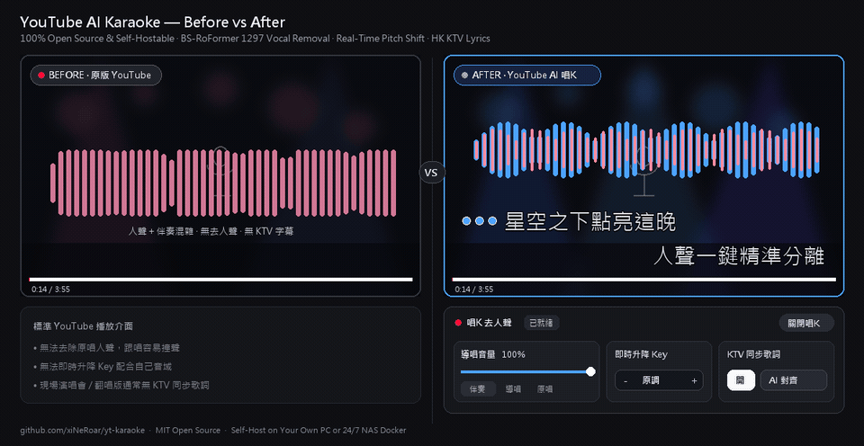
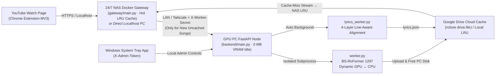

<div align="center">

# 🎤 YouTube AI Karaoke

**Turn any YouTube MV or live concert into a studio-grade Hong Kong KTV experience — right inside YouTube.**

**100% Open Source & Self-Hostable** — runs completely on **your own PC** or **your own 24/7 NAS + GPU PC**, with zero dependency on any external server!

[](LICENSE)
[](extension/)
[](backend/)
[](gateway/)

<br />

### 🎬 Before vs After Demo / 效果對比



<sub>HD MP4 version: <a href="docs/demo-comparison.mp4"><code>docs/demo-comparison.mp4</code></a> · Full-player preview: <a href="docs/hero-preview.jpg"><code>docs/hero-preview.jpg</code></a></sub>

</div>

---

## ✨ Highlights / 核心功能

- **Studio-Grade AI Vocal Removal (`BS-RoFormer 1297`)**
  Separates any YouTube song into crisp **Instrumental** + **Vocals** stems (`overlap=4`, `320k MP3`, ~13 dB SDR) — zero muddy phase-cancellation echoes.
- **Native YouTube Studio Control Bar**
  Automatically matches YouTube Dark & Light themes:
  - **Guide Vocal Slider (0%–100%)** + 1-click presets (`伴奏 / 導唱 / 原唱`)
  - **Real-Time Pitch Shift (±6 semitones)** preserving tempo (bit-perfect bypass at original key)
  - **Sample-Accurate Dual-Track Sync** following play/pause, seek, speed, and volume + optional `±25ms` sync chip
- **Eye-Friendly Hong Kong KTV Sweeping Lyrics (On-Demand)**
  - Clean Medium-weight (`500`) sky-blue (`#4DA3FF`) 60fps sweeping lyrics + 3-dot intro countdown.
  - **Smart HK KTV Line Breaking**: Uses Chromium's native `Intl.Segmenter("zh-Hant")` + singer breath-pause detection to keep every line crisp (`≤ 10` CJK chars) at 100% uniform font size — never clips off-screen.
  - **4-Layer Hybrid Live-Aware Lyrics Engine**:
    1. YouTube human subtitles (`yue-HK` / `zh-HK` / `zh-TW` / `en` / `ja` / `ko`)
    2. Dual official lyric lookup (`LRCLIB` + `NetEase` with HK/TW/CN variant matching & strict title validation)
    3. YouTube description lyric extractor (for parodies / 改詞版 / indie covers)
    4. **GPU Batched Section-Anchored Alignment (`stable-ts` + `faster-whisper large-v3-turbo`)** — handles live concerts that start mid-song, skip or swap verses, repeat encores, or include stage talking, AND auto-pre-generates lyrics in background right after separation!
- **Dynamic GPU ↔ CPU VRAM Guard (Coexists with Gaming & Local AI)**
  - Main FastAPI server imports **zero PyTorch (`0 MB VRAM` idle)**.
  - Isolated worker subprocess checks free VRAM **before every ~8s chunk** — seamlessly yields 100% VRAM to games or local AI models mid-song and hops back to GPU when VRAM recovers.
- **24/7 Split Architecture (Optional NAS Docker Gateway)**
  - Keep a lightweight (~80 MB RAM, 0% GPU) Docker Gateway running 24/7 on your NAS or VPS with hot LRU cache + Google Drive (`rclone` `drive.file`) cloud cache.
  - When your GPU PC is powered off, **all cached songs keep playing 24/7 at ~40ms**, while uncached songs politely show `"AI 伺服器休息中，現有歌庫仍可免費唱"`.
- **Windows Native System Tray Controller**
  - Zero-dependency 42 KB C# WinForms `.exe` (`tray-app/TrayApp.cs`) with live connected users, queue/rate-limit controls, clickable cached song library, 1-click Chrome extension reload, and Google Drive migration.

---

## 🏗 Architecture / 系統架構



---

## 🚀 Self-Hosting Guide / 自行架設教學（無需依賴任何第三方伺服器）

This repository defaults to **100% local self-hosting (`http://127.0.0.1:18765`)**. You never have to connect to anyone else's machine — choose whichever deployment mode fits you best:

### Mode A: Single-PC Local Self-Host (Easiest — 3 Minutes)
Runs completely on your own computer (`localhost` only, no domain or NAS needed):

#### 1. Prerequisites
- **Python 3.11** (managed automatically via [`uv`](https://docs.astral.sh/uv/))
- **FFmpeg** (`winget install Gyan.FFmpeg.Essentials` on Windows / `brew install ffmpeg` on macOS / `apt install ffmpeg` on Linux)
- **NVIDIA GPU (CUDA 12.8)** recommended (automatic CPU fallback supported)
- *(Optional)* **`rclone`** (`winget install Rclone.Rclone`) for zero-disk Google Drive cache

#### 2. Start the Local AI Backend
```bash
git clone https://github.com/xiNeRoar/yt-karaoke.git
cd yt-karaoke/backend
uv sync --python 3.11
uv run python main.py
```
The server starts locally at **`http://127.0.0.1:18765`**.

#### 3. Load the Chrome Extension
1. Open `chrome://extensions/` and toggle **Developer mode** ON.
2. Click **Load unpacked** and select the [`extension/`](extension/) folder.
3. Open any YouTube music video and click **開始唱K** right below the video player!

#### 4. (Optional) Build the Windows System Tray App
No Visual Studio required (uses built-in .NET Framework 4.x):
```powershell
node tray-app/make_ico.js
C:\Windows\Microsoft.NET\Framework64\v4.0.30319\csc.exe /nologo /target:winexe /optimize+ /utf8output /win32icon:tray-app/app.ico /out:"YouTube AI Karaoke.exe" /r:System.dll /r:System.Drawing.dll /r:System.Windows.Forms.dll /r:System.Web.Extensions.dll tray-app/TrayApp.cs
```

---

### Mode B: 24/7 NAS Docker Gateway + GPU PC Split (Share with Friends / Chrome Web Store)
Keep your song library online **24/7** even when your GPU PC is turned off!

#### 1. Configure Google Drive Cloud Cache (Optional but Recommended)
Create a least-privilege `rclone` remote named `ytkaraoke_gdrive` with `scope = drive.file` so it can only access its own `YT-Karaoke-Cache` folder:
```bash
rclone config create ytkaraoke_gdrive drive scope=drive.file
```

#### 2. Pair Your GPU PC & NAS with a Shared Secret
1. Generate a random 256-bit secret and save it into `backend/.worker_secret` (gitignored).
   - When `backend/.worker_secret` exists, `backend/main.py` automatically listens on `0.0.0.0:18765` and rejects any non-localhost request without a matching `X-Worker-Secret` header (`403`).
2. Add a strict firewall rule on your GPU PC allowing **ONLY your NAS IP** on TCP `18765`:
   ```powershell
   # Run in Administrator PowerShell (replace <NAS_IP> with your NAS LAN IP)
   New-NetFirewallRule -DisplayName "YT-Karaoke-GPU-From-NAS-Only" -Direction Inbound -Protocol TCP -LocalPort 18765 -RemoteAddress <NAS_IP> -Action Allow -Profile Any
   ```

#### 3. Deploy the 24/7 Gateway on NAS (Docker Compose / Portainer)
```bash
cd gateway
cp .env.example .env
# Edit .env: set GPU_NODE_URL=http://<GPU_PC_IP>:18765 and WORKER_SECRET=<same secret>
# Copy your rclone.conf into ./gateway/rclone.conf
docker compose up -d --build
```
*(A prebuilt multi-arch non-root image is also published automatically at `ghcr.io/xineroar/yt-karaoke-gateway:latest`.)*

#### 4. Expose Over HTTPS via Reverse Proxy (Nginx / Nginx Proxy Manager / Cloudflare)
Point `https://karaoke.yourdomain.com` → `http://<NAS_IP>:18766` with SSL enabled. See [`docs/nginx-reverse-proxy.conf`](docs/nginx-reverse-proxy.conf) for custom rules blocking `/api/admin` & `/api/settings` (`403`) and disabling proxy buffering for instant streaming.

---

### Mode C: Build a Custom-Domain / Chrome Web Store `.zip`
Point the extension to **your own** HTTPS domain in one command (without modifying the self-host `extension/` folder):
```bash
python scripts/build-store-package.py --api-base https://karaoke.yourdomain.com --out my-karaoke-store.zip
```
Upload `my-karaoke-store.zip` to the Chrome Web Store Developer Dashboard (or pass `--unpacked-dir extension-prod` to load it unpacked locally).

---

## 🔒 Security Design / 安全設計

- **Localhost-only by default** (`KARAOKE_HOST=127.0.0.1`, Swagger `/docs` & `/openapi.json` disabled).
- **Non-Root Hardened Gateway Container** (`USER appuser`) with zero `/api/admin` or `DELETE` endpoints exposed to the public internet.
- **Strict Origin Allowlist + Optional Extension ID Lock** (`ALLOWED_EXTENSION_IDS`).
- **256-bit Shared Worker Secret (`X-Worker-Secret`) + Per-Session Admin Token (`X-Admin-Token`)**.
- **Multi-User Concurrency & Overload Guard**: Strict single-worker GPU queue, job deduplication (100 users requesting the same song separate it once), per-IP rate limiting, 15-minute duration cap, and livestream blocking.
- **Zero SSRF / Path Traversal**: Canonical YouTube URLs are constructed strictly from regex-validated 11-character IDs (`^[A-Za-z0-9_-]{11}$`).
- **Least-Privilege Google Drive Scope (`drive.file`)**: Cannot read any other files in your Drive.

---

## ⚠️ Disclaimer / 免責聲明

This project is intended for **personal, educational, and non-commercial karaoke use**. Users are responsible for complying with YouTube's Terms of Service and applicable copyright laws in their jurisdiction.

## 📄 License

Distributed under the [MIT License](LICENSE).
