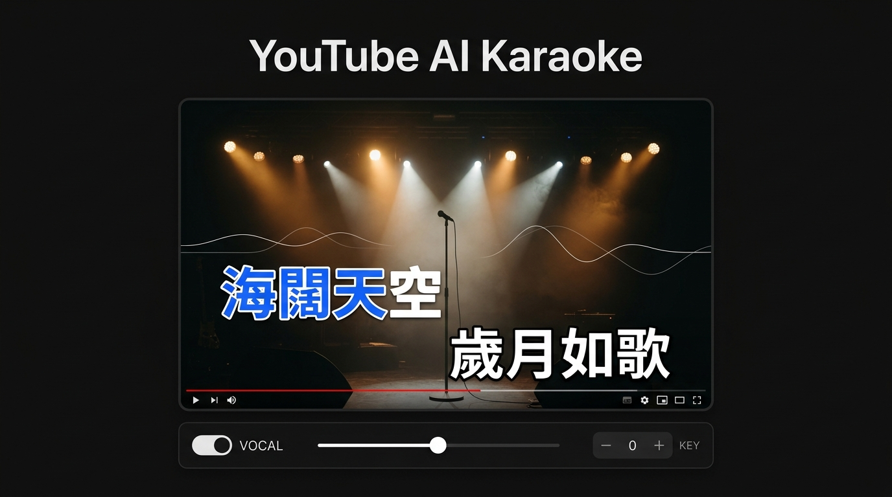
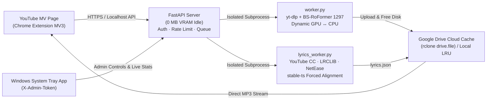

<div align="center">

# 🎤 YouTube AI Karaoke

**Turn any YouTube MV or live concert into a studio-grade Hong Kong KTV experience — right inside YouTube.**

[](LICENSE)
[](extension/)
[](backend/)
[-229648.svg?style=flat-square)](backend/lyrics_worker.py)

<br />



</div>

---

## ✨ Highlights / 核心功能

- **Studio-Grade AI Vocal Removal (`BS-RoFormer 1297`)**
  Unlike browser phase-cancellation filters that leave muddy echoes, YouTube AI Karaoke separates every track into clean **Instrumental** + **Vocals** stems (SDR ~12.97 dB) with zero compromise on drums, bass, or guitars.
- **Native YouTube Studio Control Bar**
  Blends seamlessly into YouTube's dark and light themes with zero visual clutter:
  - **Guide Vocal Slider (0%–100%)** + 1-click presets (`伴奏 / 導唱 / 原唱`)
  - **Real-Time Pitch Shift (±6 semitones)** preserving original tempo (bit-perfect bypass at original key)
  - **Sample-Accurate Dual-Track Sync** following YouTube play/pause, seeking, playback speed, and volume + optional `±25ms` fine-tuning
- **Classic Hong Kong KTV Dual-Line Sweeping Lyrics (On-Demand)**
  - Toggle **OFF by default** so MVs with burned-in lyrics stay unobstructed; click **開** on any lyric-less MV or live concert.
  - **3-Layer Hybrid Lyrics Engine**:
    1. YouTube human-authored subtitles (`yue-HK` / `zh-HK` / `zh-TW` / `en` / `ja` / `ko`)
    2. Official lyrics databases (`LRCLIB` + `NetEase`) for exact studio tracks
    3. **AI Forced Alignment (`stable-ts` + `faster-whisper large-v3-turbo`)** aligning 100% real official lyrics directly onto the isolated `vocals.mp3` — zero typos and exact millisecond timing even on live concerts & covers!
  - Staggered top-left / bottom-right HK KTV layout with 60fps royal-blue sweeping highlight and 3-dot intro countdown.
- **Dynamic GPU ↔ CPU VRAM Guard (Safe Alongside Gaming & Local AI)**
  - Main FastAPI server **never loads PyTorch (`0 MB VRAM` idle)**.
  - Isolated worker subprocesses monitor live free VRAM **before every ~8s audio chunk** — if a game or local video-gen model needs VRAM, the worker seamlessly shifts to CPU and releases 100% VRAM mid-song, then hops back to GPU the moment VRAM frees up!
- **Zero-Disk Google Drive Cloud Cache & Cloud Logs**
  - Optional `rclone` integration (least-privilege `drive.file` scope) uploads separated stems, `lyrics.json`, and daily structured logs to `My Drive/YT-Karaoke-Cache/` and deletes local copies immediately (**0 MB local disk**).
- **Windows Native System Tray Controller + Multi-User Protection**
  - Lightweight 42 KB native C# WinForms Tray App (`tray-app/TrayApp.cs`) with Start/Stop toggle, live connected users & singing counter, cached song list with clickable YouTube links, 1-click auto-reload Chrome Extension, and multi-user overload controls (queue limit, per-IP rate limiting, pause-new-jobs switch).

---

## 🏗 Architecture / 系統架構



---

## 🚀 Quick Start / 快速安裝

### Prerequisites / 環境需求
- **Python 3.11** (managed automatically via [`uv`](https://docs.astral.sh/uv/))
- **FFmpeg** (`winget install Gyan.FFmpeg.Essentials`)
- **NVIDIA GPU (CUDA 12.8)** recommended (CPU fallback supported automatically)
- *(Optional)* **`rclone`** (`winget install Rclone.Rclone`) for zero-disk Google Drive cloud cache

### 1. Start the AI Backend
```bash
cd backend
uv sync --python 3.11
uv run python main.py
```
The server starts on `http://127.0.0.1:18765` (localhost-only by default).

### 2. Load the Chrome Extension
1. Open `chrome://extensions/` and enable **Developer mode**.
2. Click **Load unpacked** (or drag and drop) the [`extension/`](extension/) folder.
3. Open any YouTube music video and click **開始唱K** right below the video player!

### 3. (Optional) Build the Windows System Tray Controller
On Windows (uses built-in .NET Framework 4.x — no Visual Studio required):
```powershell
node tray-app/make_ico.js
C:\Windows\Microsoft.NET\Framework64\v4.0.30319\csc.exe /nologo /target:winexe /optimize+ /utf8output /win32icon:tray-app/app.ico /out:"YouTube AI Karaoke.exe" /r:System.dll /r:System.Drawing.dll /r:System.Windows.Forms.dll /r:System.Web.Extensions.dll tray-app/TrayApp.cs
```

### 4. (Optional) Self-Host Behind NAS / Nginx Reverse Proxy
See [`docs/nginx-reverse-proxy.conf`](docs/nginx-reverse-proxy.conf) for a production-ready HTTPS Nginx template that blocks all `/api/admin/*` routes from the public internet, enforces rate limits, and disables buffering for instant MP3 streaming.

---

## 🔒 Security Design / 安全設計

- **Localhost-only by default** (`KARAOKE_HOST=127.0.0.1`, Swagger `/docs` disabled).
- **Strict Origin Allowlist**: Only `https://www.youtube.com` and Chrome Extensions are permitted; untrusted websites receive `403 Forbidden`.
- **256-bit Admin Token (`X-Admin-Token`)**: Generated locally per session for operator-only controls (GPU/CPU switching, cache purge, extension reload, Google Drive migration).
- **Zero SSRF / Path Traversal**: Client URLs are never passed to `yt-dlp`; canonical YouTube URLs are built strictly from regex-validated 11-character video IDs (`^[A-Za-z0-9_-]{11}$`), with a 15-minute duration cap and livestream block.
- **Least-Privilege Google Drive Scope**: Uses `drive.file` so `rclone` can only access files created by this app.

---

## ⚠️ Disclaimer / 免責聲明

This project is intended for **personal, educational, and non-commercial karaoke use**. Users are responsible for complying with YouTube's Terms of Service and applicable copyright laws in their jurisdiction.

## 📄 License

Distributed under the [MIT License](LICENSE).
